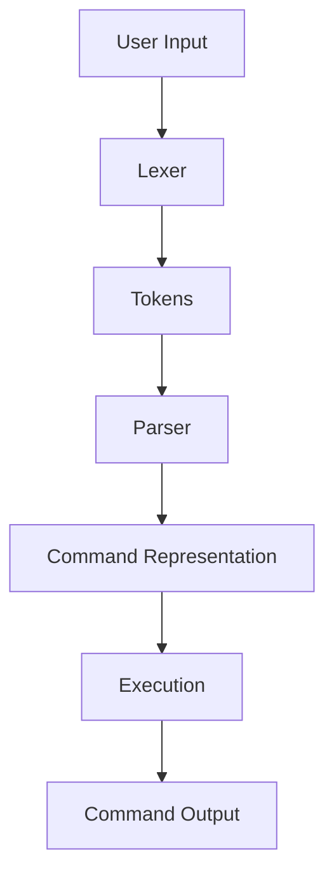

# Architecture

`rustsh` follows a modular architecture that separates command-line input, lexical analysis, parsing, and command execution.

## Overview

The shell consists of three main modules:

- **Lexer** – Converts raw user input into a sequence of tokens.
- **Parser** – Analyzes tokens and builds a structured representation of commands.
- **Execution** – Executes built-in commands and external programs, manages pipelines, handles I/O redirection, and controls foreground/background jobs.

## Execution Flow

The command-processing pipeline follows this sequence:



### 1. User Input

The shell reads commands interactively from standard input.

Example:

```bash
ls -l | grep ".rs" > output.txt
```

### 2. Lexer

The lexer converts the input string into tokens.

For example:

```text
Input:
ls -l | grep ".rs" > output.txt
```

Produces tokens conceptually equivalent to:

```text
Word("ls")
Word("-l")
Pipe
Word("grep")
Word(".rs")
RedirectStdout
Word("output.txt")
```

The lexer is responsible for recognizing command arguments, operators, and redirection syntax.

### 3. Parser

The parser consumes the token sequence and builds a structured command representation.

For example:

```text
Pipeline
├── SimpleCommand
│   ├── args: ["ls", "-l"]
│   └── stdout: Terminal
└── SimpleCommand
    ├── args: ["grep", ".rs"]
    └── stdout: File("output.txt")
```

The parser handles command structure, pipelines, redirections, and execution mode.

### 4. Execution

The execution module receives the parsed command representation and executes it.

Its responsibilities include:

- Executing built-in commands.
- Launching external programs.
- Creating and managing pipelines.
- Handling standard input, output, and error redirection.
- Managing processes and process groups.
- Controlling foreground and background jobs.
- Handling Unix signals and terminal ownership.

## Module Responsibilities

| Module | Responsibility |
|---|---|
| Lexer | Tokenize user input |
| Parser | Build command representations |
| Execution | Execute commands and manage processes |

## Design Principles

- **Separation of concerns:** Each module has a clearly defined responsibility.
- **Structured command representation:** The execution module operates on parsed commands rather than raw input strings.
- **Process isolation:** External commands run in separate processes.
- **Unix job control:** Process groups and terminal control provide foreground and background job management.
